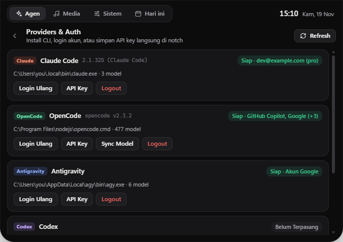

# Nimbus

[](https://github.com/nataaaf-code/nimbus/actions/workflows/ci.yml)

A floating notch for Windows that keeps your AI coding agents, music, and system controls one glance away. Built with Tauri 2 (Rust) and vanilla ES modules — no framework, no bundler.

> Windows doesn't have a physical notch, so we made one.


## Features

### AI agent hub

- **Five providers in one list** — Claude Code, OpenCode, Antigravity, Codex, and Gemini CLI sessions from any terminal or IDE
- **Install and sign in from the notch** — detects the CLI, runs the install command, starts the login flow, or stores an API key
- **Live session state** — running, waiting for permission, or idle, with project, branch, model, and token usage
- **Tool-call timeline** — every edit, command, and search in order, with the diff or output a click away
- **Allow / Deny gate** — answer Claude Code permission prompts from the bar instead of the terminal
- **Start a headless run** — pick a provider and model, type a prompt, and watch it from the notch



### Everything else

- **Music**: search and play YouTube Music directly in the notch (InnerTube, no external app or login), with synced lyrics, album view, and queue; falls back to SMTC for other players
- **Audio spectrum** — real WASAPI loopback capture, Goertzel FFT, 52 bands at ~60 fps
- **System controls** — volume, brightness, Wi-Fi, and Bluetooth in one click
- **Google Calendar** — today's events at a glance via your calendar's secret iCal URL (no OAuth setup needed)
- **Global hotkey** — `Ctrl+Alt+Space` toggles the bar from anywhere
- **Line mode** — collapses to a 5 px pulsing glow when a browser window sits under the notch

## Install

Download the latest installer from [Releases](../../releases) and run it. Windows 10/11 x64, WebView2 required (pre-installed on Windows 11).

The build is not code-signed, so SmartScreen will warn you: **More info → Run anyway**.

## Build from source

You need Windows 10/11, [Rust](https://rustup.rs/) with the MSVC toolchain, [Visual Studio Build Tools](https://visualstudio.microsoft.com/downloads/) with the C++ workload, Node.js 18+, and WebView2.

```bash
git clone https://github.com/nataaaf-code/nimbus.git
cd nimbus
npm install
npm run dev     # development mode with hot-reload
npm run build   # NSIS installer in src-tauri/target/release/bundle
```

`npm run icon` regenerates the icon set from `app-icon.png` if you change it.

Opening `ui/index.html` in a browser renders the UI shell; every system integration shows a "Run as Windows app" message instead of failing.

## Supported agents

| Provider | CLI | Sign-in methods |
|---|---|---|
| Claude Code | `claude` | CLI login, `ANTHROPIC_API_KEY` |
| OpenCode | `opencode` | CLI login, `OPENROUTER_API_KEY`, model sync |
| Antigravity | `agy` | Google account via CLI, `GEMINI_API_KEY` |
| Codex | `codex` | CLI login, `OPENAI_API_KEY` |
| Gemini CLI | `gemini` | Google OAuth, `GEMINI_API_KEY` |

Claude Code and OpenCode are the most tested; Codex, Gemini CLI, and Antigravity go through the same adapter and may still need fixes. Reports are welcome.

### Claude Code integration

Session transcripts are read from `~/.claude/projects/`, so the hub works with zero setup. The live status and Allow/Deny gate need a hook, installed from the gear icon in the Agents tab — it adds a single entry to `~/.claude/settings.json`.

## Google Calendar setup (optional)

1. Open [Google Calendar](https://calendar.google.com/) in your browser
2. Click the gear icon → **Settings** → select your calendar in the left sidebar
3. Scroll to **Integrate calendar** → copy **Secret address in iCal format**
4. Open the **Hari ini** tab in Nimbus and paste the URL (stored in `%APPDATA%\Nimbus\config.json` as `{ "ics_url": "..." }`)

## Project structure

```
ui/
  index.html          main window
  css/app.css         all styles
  js/
    core.js           notch state machine, event bus
    agents.js         agent hub + provider setup
    media.js          music + audio spectrum
    system.js         volume, brightness, Wi-Fi, Bluetooth
    today.js          Google Calendar
    main.js           entry point
src-tauri/src/
  main.rs             Tauri setup, commands, window/input loop
  agents.rs           provider detection, install/login, headless runs
  cc.rs               Claude Code session reader + hook installer
  spectrum.rs         WASAPI loopback → Goertzel FFT → Tauri events
  sys.rs              system controls (volume, brightness, radios)
  win.rs              Windows-specific helpers (hit-test, browser detection)
  google.rs           Google Calendar iCal feed parser
```

Adding a provider touches `PROVIDER_DEFS` in `agents.rs` plus its lookup and auth branches; UI labels live in `PROV_LBL` in `ui/js/agents.js`. [CONTRIBUTING.md](CONTRIBUTING.md) has the details.

## Privacy and local data

Nimbus runs on your machine and has no backend. It reads local session files and talks to provider CLIs directly.

| Path | Contents |
|---|---|
| `%APPDATA%\Nimbus\provider_keys.json` | Provider API keys you enter in the app |
| `%APPDATA%\Nimbus\config.json` | Google Calendar secret iCal URL (`ics_url`) |
| `%APPDATA%\Nimbus\*.json` | Hook secret token, session titles, local app state |

API keys are stored as plain JSON today, readable by anything running as your user. Prefer the CLI login flow when you can, and see [SECURITY.md](SECURITY.md) for the current status and the planned DPAPI migration.

## Environment variables

| Variable | Description |
|---|---|
| `NOTCH_CLAUDE_BIN` | Override the auto-detected path to the `claude` CLI |

## Contributing

Issues, bug reports, and pull requests are welcome. Start with [CONTRIBUTING.md](CONTRIBUTING.md) for setup, architecture, and scope. This project is Windows-only by design: it relies on Tauri's transparent always-on-top window, WASAPI loopback, and `Windows.Media.Control`.

## License

MIT — see [LICENSE](LICENSE).
