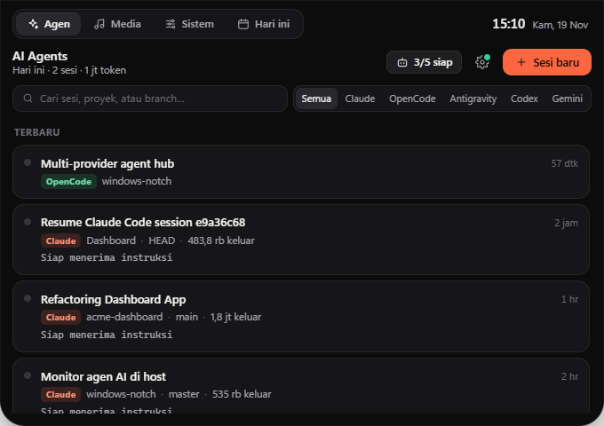

# Nimbus

A floating notch bar for Windows — real-time **Claude Code** agent monitor, music player with live audio spectrum, system controls, and Google Calendar. Built with Tauri 2 + vanilla ES modules, no bundler.

> Windows doesn't have a physical notch, so we made one.



---

## Features

- **Claude Code Hub** — live agent sessions from any terminal or IDE, tool-call timeline, token/cost tracker, Allow/Deny permission gate directly from the bar
- **Music** — now playing from any Windows media source (Spotify, YouTube Music, browsers) via SMTC, no login needed
- **Audio Spectrum** — real WASAPI loopback capture → Goertzel FFT → 52-band visualizer at ~60fps
- **System Controls** — volume, brightness, Wi-Fi, Bluetooth, all in one click
- **Google Calendar** — today's events at a glance (optional, requires OAuth setup)
- **Global Hotkey** — `Ctrl+Alt+Space` toggles the bar from anywhere
- **Line Mode** — collapses to a 5px pulsing glow when a browser window is under the notch area

---

## Prerequisites

- Windows 10 / 11
- [Rust](https://rustup.rs/) with the MSVC toolchain
- [Visual Studio Build Tools](https://visualstudio.microsoft.com/downloads/) with the C++ workload
- Node.js 18+
- WebView2 (pre-installed on Windows 11; download from Microsoft for Windows 10)

---

## Run

```bash
npm install
npm run icon    # one-time: generates icons from app-icon.png
npm run dev     # development mode with hot-reload
npm run build   # produces NSIS installer in src-tauri/target/release/bundle
```

Opening `ui/index.html` directly in a browser shows the UI shell; all system integrations display a "Run as Windows app" message.

---

## Project Structure

```
ui/
  index.html          main window
  css/app.css         all styles
  js/
    core.js           notch state machine, event bus
    agents.js         Claude Code hub
    media.js          music + audio spectrum
    system.js         volume, brightness, Wi-Fi, Bluetooth
    today.js          Google Calendar
    main.js           entry point
src-tauri/src/
  main.rs             Tauri setup, commands, window/input loop
  cc.rs               Claude Code session reader + hook installer
  spectrum.rs         WASAPI loopback → Goertzel FFT → Tauri events
  sys.rs              system controls (volume, brightness, radios)
  win.rs              Windows-specific helpers (hit-test, browser detection)
  google.rs           Google Calendar OAuth + API
```

No framework, no bundler — ES modules loaded directly. Fast iteration, zero build step for UI changes.

---

## Google Calendar Setup (optional)

1. [Google Cloud Console](https://console.cloud.google.com/) → create a project → enable **Google Calendar API**
2. OAuth consent screen → External → Testing → add your Google account as a test user
3. Credentials → Create → OAuth client ID → type **Desktop app**
4. Create `%APPDATA%\Nimbus\config.json`:
   ```json
   { "google_client_id": "...apps.googleusercontent.com", "google_client_secret": "..." }
   ```
5. Open the Today tab → Connect Google → browser opens → done

---

## Claude Code Integration

Works out of the box with zero setup — reads session transcripts from `~/.claude/projects/`.

For live status and the Allow/Deny permission gate, install the hook via the gear icon in the Agents tab. This writes a single entry to `~/.claude/settings.json`.

---

## Environment Variables

| Variable | Description |
|---|---|
| `NOTCH_CLAUDE_BIN` | Override auto-detected path to the `claude` CLI binary |

---

## Contributing

Pull requests welcome. This project is Windows-only by design (Tauri's transparent always-on-top window + WASAPI + Windows.Media.Control). Issues and feature requests via GitHub Issues.

---

## License

MIT
